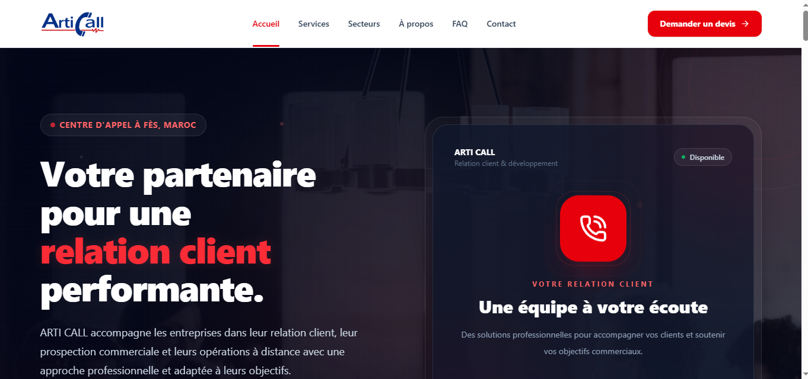

# ARTI CALL – Company Website

A professional and responsive website developed for ARTI CALL, a company specialized in call center and telemarketing services.

## About the Project

ARTI CALL is a web project designed to present the company's services, business sectors, and contact information through a modern and user-friendly interface.

## Main Features

- Homepage presenting the company.
- About Us page.
- Services presentation.
- Business sectors pages.
- Contact form.
- Online quotation request form.
- FAQ section.
- Email notifications for contact and quotation requests.
- Responsive website interface.

## Technologies Used

- PHP
- Laravel
- Blade
- HTML5
- CSS3
- JavaScript
- MySQL
- Vite
- Git & GitHub

## Project Structure

```text
app/
├── Http/Controllers/
├── Mail/
└── Models/

resources/
├── css/
├── js/
└── views/

routes/
└── web.php

database/
├── migrations/
└── seeders/
```

## Installation

1. Clone the repository:

```bash
git clone https://github.com/ayyoubboss7-sudo/call.git
```

2. Open the project directory:

```bash
cd call
```

3. Install PHP dependencies:

```bash
composer install
```

4. Create your environment file:

```bash
copy .env.example .env
```

5. Generate the application key:

```bash
php artisan key:generate
```

6. Configure your database settings in the `.env` file.

7. Run database migrations:

```bash
php artisan migrate --seed
```

8. Install frontend dependencies:

```bash
npm install
npm run build
```

9. Start the development server:

```bash
php artisan serve
```

## Developer

**Ayyoub El-Araby**

Web Developer | Laravel & PHP | WordPress | JavaScript

GitHub: [@ayyoubboss7-sudo](https://github.com/ayyoubboss7-sudo)

---

Developed as a web development project using Laravel and modern web technologies.
## Screenshots

### Homepage


